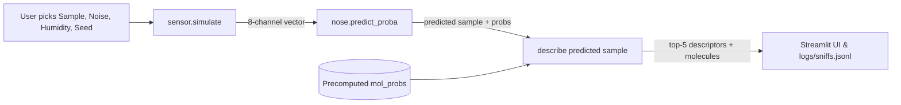

# Smell AI — Project Sketch

## 1. High-Level Summary

**Purpose:** Smell AI is a local Python + Streamlit application that joins a molecule-to-odor model (SMILES to 138 OpenPOM odor descriptors) with a simulated 8-channel electronic nose (8 RDKit-derived sensor channels classifying 6 smell samples). It demonstrates an end-to-end olfactory inference pipeline on a laptop CPU with no GPU, no hardware sensors, and no API keys.

**Stack:**
- **Language & Runtime:** Python 3.10–3.12 (`.venv`, CPU-only)
- **Chemistry & ML:** `rdkit`, `scikit-learn`, `numpy`, `pandas`, `joblib`
- **Web UI:** `streamlit` (minimal light Y2K theme via `.streamlit/config.toml` + custom CSS in `app.py`)
- **Data & HTTP:** `requests` (downloads the 4,983-molecule OpenPOM CSV)
- **Containerization:** `Dockerfile` + `.dockerignore`

**Core Workflows:**
1. **Offline Training (two steps):**
   - `smell_model.py` downloads `curated_GS_LF_merged_4983.csv`, featurizes molecules into 2048-bit Morgan count fingerprints, trains a 300-tree multi-output `RandomForestClassifier` across 138 descriptors, and saves `models/smell.joblib`, `models/descriptors.json`, and `models/smell_metrics.json`.
   - `train_nose.py` builds a seeded 8-channel `SensorBank` (`models/sensor_bank.json`), generates 200 simulated sessions per sample (1,200 total), trains a 200-tree `RandomForestClassifier`, and saves `models/nose.joblib` and `models/nose_metrics.json`.
2. **Online Inference (`pipeline.sniff()`):**
   - `pipeline.load_all()` loads both models, `samples.json`, and `sensor_bank.json`, and precomputes the 138 descriptor probabilities for all 37 sample molecules.
   - `sniff(ctx, sample_id, noise, humidity, seed)` simulates an 8-channel sensor reading from the presented sample, runs the nose classifier to get a predicted sample + confidence, looks up the **predicted** sample's precomputed molecule probabilities, ranks descriptors by `score * sqrt(lift)`, and logs the event to `logs/sniffs.jsonl`.
3. **Web Console (`app.py`):**
   - Provides 8 interactive tabs (`SNIFF LAB`, `BATCH ARENA`, `MOLECULE LAB`, `SENSOR SWEEP`, `MODEL METRICS`, `SAMPLE LIBRARY`, `SNIFF LOG`, `DOCUMENTATION`) plus a first-boot **INITIALIZE MODELS** screen if `models/` artifacts are missing.

---

## 2. Visual Sketch

### System Architecture & Data Flow (ASCII)

```text
  [OpenPOM CSV (4,983 mols)]                [samples.json (6 samples, 37 mols)]
             |                                               |
             v                                               v
      smell_model.py                                     sensor.py
   (Morgan FP, 2048-bit)                         (8 RDKit props -> 8 sensors)
             |                                               |
             v                                               v
   models/smell.joblib                            models/sensor_bank.json
   models/descriptors.json                                   |
   models/smell_metrics.json                                 v
             |                                         train_nose.py
             |                                    (1,200 sim sessions, RF-200)
             |                                               |
             |                                               v
             |                                     models/nose.joblib
             |                                     models/nose_metrics.json
             |                                               |
             +----------------------+------------------------+
                                    |
                                    v
                              pipeline.py
                 load_all() -> precomputes mol_probs
                 sniff(sample, noise, humidity, seed)
                   1. sensor.simulate() -> 8-vector
                   2. nose.predict_proba() -> predicted sample
                   3. describe(predicted) -> top-5 via score*sqrt(lift)
                   4. append -> logs/sniffs.jsonl
                                    |
                                    v
                        app.py (SMELL//OS Web UI)
```

### Inference Flow (Mermaid)



### Web UI Layout Sketch (Minimal Light Y2K)

```text
+--------------------+-------------------------------------------------------+
| SIDEBAR            |  HERO: SMELL//OS  [ONLINE] [NOSE: SIMULATED] [LOADED] |
|  SMELL//OS         +-------------------------------------------------------+
|  Sample: [Mint v]  | [SNIFF LAB] [BATCH ARENA] [MOLECULE LAB] [SWEEP] ...  |
|  Noise:  [--o---]  +-------------------------------------------------------+
|  Humid:  [---o--]  |  > INITIATE SNIFF                                     |
|  Seed:   [blank ]  |  +-------------------+  +--------------------------+  |
|                    |  | 8-Channel Sensors |  | Nose Guess & Confidence  |  |
|  SMELL AUC: 0.832  |  | S1..S8 bar chart  |  | Predicted: Mint (98.5%)  |  |
|  NOSE ACC:  96.7%  |  +-------------------+  +--------------------------+  |
|  [SYSTEM]          |  +-------------------------------------------------+  |
|                    |  | Top-5 Odor Descriptors (score * sqrt(lift))     |  |
|  NOSE: SIMULATED   |  | mint | herbal | fresh | woody | pine            |  |
+--------------------+--+----------------------------------------------------+
```

---

## 3. Module & File Breakdown

| Path | Role |
|---|---|
| `smell_model.py` | Downloads/loads `curated_GS_LF_merged_4983.csv`, extracts Morgan count fingerprints, trains 300-tree RF on 138 descriptors, evaluates macro ROC-AUC (`0.832`), saves `smell.joblib`, `descriptors.json`, `smell_metrics.json`. |
| `sensor.py` | Computes 8 RDKit molecular properties (`mw`, `logp`, `o_frac`, `s_count`, `n_count`, `aromatic_rings`, `tpsa`, `hbd`), builds/loads `SensorBank` (`seed=7`), simulates 8-channel sensor responses with volatility, saturation, humidity, drift, and noise. |
| `train_nose.py` | Generates 200 simulated sessions per sample (80/20 stratified split), trains 200-tree RF nose classifier (`96.7%` default-noise accuracy), evaluates noise degradation curve (`0.03` to `0.30`), saves `nose.joblib` and `nose_metrics.json`. |
| `pipeline.py` | Core runtime orchestrator: `load_all()`, `sniff()`, `describe()`, `missing_model_files()`. Precomputes sample molecule probabilities at load and appends sniff events to `logs/sniffs.jsonl`. |
| `app.py` | Minimal light Y2K Streamlit console (`SMELL//OS`) with 8 main tabs, 10 documentation sub-tabs, sidebar controls, and missing-model bootstrapper. |
| `test_app.py` | 7-check headless verification suite (model files, SMILES parsing, `sniff()` schema, 20-sniff accuracy spot check, descriptor sanity, probability normalization, fixed-seed determinism). |
| `samples.json` | 6 sample compositions (`coffee`, `vanilla_candle`, `mint`, `lemon`, `banana`, `wood_smoke`) totaling 37 molecules with relative weights. |
| `models/` | Trained artifacts (`*.joblib` gitignored) and committed JSON metadata (`descriptors.json`, `smell_metrics.json`, `sensor_bank.json`, `nose_metrics.json`). |
| `data/` | Downloaded OpenPOM dataset (`curated_GS_LF_merged_4983.csv`, gitignored). |
| `logs/` | Runtime sniff history (`sniffs.jsonl`, gitignored). |
| `docs/` | Project specifications and guides: `PRD.md`, `TRD.md`, `BACKEND_SCHEMA.md`, `ALGORITHMS.md`, `APP_FLOW.md`, `WEB_APP.md`, `DEPLOYMENT.md`. |
| `.streamlit/config.toml` | Light Y2K Streamlit theme configuration (`#f4f7fc` background, `#0066ff` primary). |
| `Dockerfile` / `.dockerignore` | Container build that installs `requirements.txt`, trains both models at build time, and serves `app.py` on port `8501`. |

---

## 4. Setup & Run Guide

### Windows (PowerShell)
```powershell
python -m venv .venv
.venv\Scripts\pip.exe install -r requirements.txt

.venv\Scripts\python.exe smell_model.py
.venv\Scripts\python.exe train_nose.py
.venv\Scripts\python.exe test_app.py
.venv\Scripts\python.exe -m streamlit run app.py
```

### macOS / Linux
```bash
python3 -m venv .venv && source .venv/bin/activate
pip install -r requirements.txt

python smell_model.py
python train_nose.py
python test_app.py
streamlit run app.py
```

### Docker
```bash
docker build -t smell-ai .
docker run -p 8501:8501 smell-ai
```
