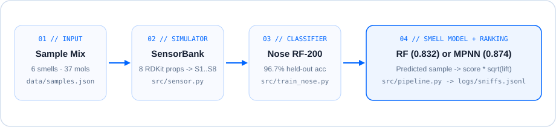
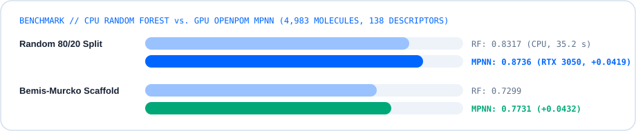

<p align="center">
  
  
  
  
  
</p>

> **Paper Reference:** Built on the curated **OpenPOM** dataset (`4,983` molecules, `138` odor descriptors) from **Lee et al.**, *"A principal odor map unifies diverse tasks in olfactory perception"*, *Science* (2023), DOI: [`10.1126/science.ade4401`](https://doi.org/10.1126/science.ade4401) and [`BioMachineLearning/openpom`](https://github.com/BioMachineLearning/openpom).

Smell AI is a local Python + Streamlit application that joins two models:

1. **Smell model** (SMILES → 138 OpenPOM odor descriptors): compares a lightweight CPU **RandomForest** on 2048-bit Morgan count fingerprints (`0.8317` macro ROC-AUC) against a GPU-trained **OpenPOM-style MPNN** on atom/bond graphs (`0.8736` random AUC, `0.7731` Bemis-Murcko scaffold AUC).
2. **Simulated electronic nose** (8 RDKit-derived sensor channels → 6 aroma samples): a 200-tree RandomForest classifying simulated sensor responses (`96.7%` held-out accuracy at default noise, degrading to `41.9%` at $\sigma = 0.30$).

Pick a smell, press **INITIATE SNIFF**, and inspect the 8 sensor channels, the nose's guess and confidence, and the smell model's lift-weighted description of the molecules behind that guess.

> **Honesty first:** the nose is simulated. Its eight channels come from RDKit molecular properties, a seeded `SensorBank`, volatility, saturation, humidity, drift, and Gaussian noise—not physical gas sensors. Its `96.7%` accuracy is measured against the same simulator that generated the training data, so it does not estimate accuracy on real hardware.

---

## Architecture



The **predicted** sample selects the molecules used for the odor description, not the presented one. If the nose guesses wrong, the description reflects that mistake honestly. Molecule probabilities for all 37 sample molecules are precomputed once in `pipeline.load_all()`, keeping `sniff()` latency around `30 ms`.

---

## Measured Results



All numbers below come directly from [`models/smell_metrics.json`](models/smell_metrics.json), [`models/gnn_metrics.json`](models/gnn_metrics.json), [`models/nose_metrics.json`](models/nose_metrics.json), and [`tests/test_app.py`](tests/test_app.py). Full tables, training curves, and top/worst per-descriptor AUCs are in [`docs/eval.md`](docs/eval.md).

| Metric | Measured | Target |
|---|---:|---:|
| Smell model (RandomForest, Random 80/20) macro ROC-AUC | **0.8317** | ≥ 0.78 |
| Smell model (OpenPOM MPNN GNN, Random 80/20) macro ROC-AUC | **0.8736** (`+0.0419`) | ≥ 0.78 |
| Smell model (Bemis-Murcko Scaffold 80/20): GNN vs. RF | **0.7731** vs. 0.7299 | — |
| Descriptors scored | 138 of 138 | 138 |
| Nose held-out accuracy (240 sessions) | **96.7%** (232/240) | ≥ 95% |
| `tests/test_app.py` 20-sniff spot check ($\sigma = 0.03$) | **95.8%** (115/120) | ≥ 95% |
| `sniff()` latency (local, 50 sniffs) | **~30 ms** mean, 44 ms max | < 300 ms |
| Smell model fit (`train_seconds`, CPU RF / RTX 3050 GNN) | 35.2 s / 87.6 s | — |
| Nose train (`train_seconds`) | 0.91 s | < 60 s |

<details>
<summary><strong>Noise Degradation Curve &amp; Held-Out Confusion Matrix (240 sessions)</strong></summary>

| Noise $\sigma$ | Accuracy |
|---:|---:|
| 0.03 | **98.7%** |
| 0.10 | 78.9% |
| 0.20 | 53.5% |
| 0.30 | 41.9% |

| Presented \ Predicted | coffee | vanilla | mint | lemon | banana | wood smoke |
|---|---:|---:|---:|---:|---:|---:|
| **coffee** | 39 | 0 | 0 | 0 | 1 | 0 |
| **vanilla** | 0 | 39 | 0 | 0 | 0 | 1 |
| **mint** | 0 | 0 | 40 | 0 | 0 | 0 |
| **lemon** | 0 | 0 | 3 | 37 | 0 | 0 |
| **banana** | 0 | 0 | 0 | 0 | 40 | 0 |
| **wood smoke** | 0 | 3 | 0 | 0 | 0 | 37 |

</details>

<details>
<summary><strong>Sample Top-5 Descriptors (score * sqrt(lift))</strong></summary>

| Sample | Top 5 Descriptors |
|---|---|
| Coffee | `caramellic`, `sweet`, `phenolic`, `coffee`, `spicy` |
| Vanilla Candle | `vanilla`, `creamy`, `sweet`, `chocolate`, `hay` |
| Mint | `mint`, `herbal`, `fresh`, `woody`, `pine` |
| Lemon | `terpenic`, `lemon`, `citrus`, `orange`, `fresh` |
| Banana | `banana`, `pear`, `solvent`, `ripe`, `fruity` |
| Wood Smoke | `phenolic`, `medicinal`, `leathery`, `vanilla`, `smoky` |

</details>

---

## Quickstart

**Windows (PowerShell):**
```powershell
uv venv .venv --python 3.12 --seed
.venv\Scripts\pip.exe install -r requirements.txt

.venv\Scripts\python.exe src\smell_model.py   # CPU RandomForest baseline
.venv\Scripts\python.exe src\train_nose.py    # Simulated electronic nose
.venv\Scripts\python.exe tests\test_app.py    # 7-check headless suite
.venv\Scripts\python.exe -m streamlit run app.py
```

**Optional GPU GNN training** (requires PyTorch CUDA; see [`requirements-gpu.txt`](requirements-gpu.txt)):
```powershell
.venv\Scripts\python.exe src\train_gnn.py     # OpenPOM MPNN + Bemis-Murcko scaffold split
```

**macOS / Linux:**
```bash
python3 -m venv .venv && source .venv/bin/activate
pip install -r requirements.txt

python src/smell_model.py
python src/train_nose.py
python tests/test_app.py
streamlit run app.py
```

If the OpenPOM download is blocked, pass a local CSV: `python src/smell_model.py --csv path/to/curated_GS_LF_merged_4983.csv`.

---

## Web App (`SMELL//OS`) & Deployment

[`app.py`](app.py) uses a minimal light Y2K theme ([`.streamlit/config.toml`](.streamlit/config.toml)) with 8 tabs: **Sniff Lab**, **Batch Arena**, **Molecule Lab** (side-by-side RF vs. MPNN comparison), **Sensor Sweep**, **Model Metrics**, **Sample Library**, **Sniff Log**, and **Documentation**.

- **Streamlit Community Cloud (CPU-only):** Set main file to `app.py` (Python 3.12). Streamlit Cloud runs on **CPU only**, so it serves the `RandomForest` baseline (`0.8317` AUC) + simulated nose; missing `models/*.joblib` files trigger a first-boot **INITIALIZE MODELS** button. For the GPU-trained OpenPOM MPNN (`0.8736` AUC), see [GitHub (`DevanshSrajput/Smell_AI`)](https://github.com/DevanshSrajput/Smell_AI).
- **Docker:** `docker build -t smell-ai . && docker run -p 8501:8501 smell-ai` (see [`docs/DEPLOYMENT.md`](docs/DEPLOYMENT.md)).

---

## Give It a Real Nose (BME688 on ESP32)

The simulator is isolated behind `sensor.simulate()`, so hardware can replace it without touching `pipeline.py` or `app.py`:

1. **Hardware:** Wire a Bosch BME688 gas sensor to an ESP32 over I2C.
2. **Heater profile:** Step the hotplate through `200, 250, 300, 350 °C` and normalize gas resistance by the clean-air baseline ($R / R_0$).
3. **Burn-in & sampling:** Run a 24-hour burn-in, record at least 3 sessions across different days (30 min per jar with clean air between; use room-temperature coffee grounds, not hot steam).
4. **Swap & retrain:** Replace `sensor.simulate()` with a CSV loader returning the same feature shape and retrain `src/train_nose.py` using a **session-level split** (never split rows from the same session across train and test).

---

## Project Layout

```text
smell-ai/
  src/
    smell_model.py                      CPU RandomForest (2048-bit Morgan FP -> 138 descriptors)
    train_gnn.py                        GPU OpenPOM MPNN + Bemis-Murcko scaffold split
    sensor.py                           Simulated 8-channel nose (RDKit properties + SensorBank)
    train_nose.py                       Session generator + 200-tree nose classifier
    pipeline.py                         load_all(), sniff(), describe(), JSONL logging
  tests/
    test_app.py                         7-check headless suite
  data/
    samples.json                        6 aroma mixes (37 molecules)
    curated_GS_LF_merged_4983.csv       Downloaded OpenPOM CSV (gitignored)
  models/
    smell.joblib | descriptors.json | smell_metrics.json
    smell_gnn.pt | gnn_metrics.json
    sensor_bank.json | nose.joblib | nose_metrics.json
  docs/                                 PRD, TRD, BACKEND_SCHEMA, ALGORITHMS, APP_FLOW,
                                        WEB_APP, DEPLOYMENT, PROJECT_SKETCH, eval, assets/
  logs/sniffs.jsonl                     Runtime sniff log (gitignored)
  .streamlit/config.toml                Minimal light Y2K theme
  Dockerfile / .dockerignore            Container deployment
  requirements.txt                      Core CPU dependencies
  requirements-gpu.txt                  Optional PyTorch CUDA for GNN training
  app.py                                Streamlit console (8 tabs)
```

---

## References & Credits

- **Paper:** Lee et al., *"A principal odor map unifies diverse tasks in olfactory perception"*, *Science* (2023), [`10.1126/science.ade4401`](https://doi.org/10.1126/science.ade4401).
- **Dataset:** `curated_GS_LF_merged_4983.csv` from [`BioMachineLearning/openpom`](https://github.com/BioMachineLearning/openpom) (MIT License; GoodScents + Leffingwell data).
- **Docs:** [`docs/eval.md`](docs/eval.md) · [`docs/PROJECT_SKETCH.md`](docs/PROJECT_SKETCH.md) · [`docs/WEB_APP.md`](docs/WEB_APP.md) · [`docs/DEPLOYMENT.md`](docs/DEPLOYMENT.md).

This is a portfolio and learning project. Do not use it for safety, medical, or fragrance-formulation decisions.
